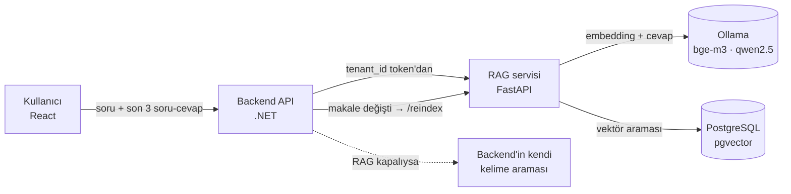

# RAG servisi v2

Model **eğitilmez**. Genel bir Türkçe dil modeli (qwen2.5) her firmanın kendi bilgi bankasından bulunan
parçalara dayanarak cevap yazar. Bilgi firmaya özel, model ortaktır. Dış yapay zekâ servisi yoktur:
embedding (`bge-m3`) ve dil modeli (`qwen2.5:3b`) bilgisayardaki Ollama'da çalışır, veri şirketten çıkmaz.

## Mimari



Bir sorunun yolculuğu (`POST /ask`):

| Adım | Ne olur | Dosya |
|---|---|---|
| 1. Güvenlik | "Önceki talimatları unut", "diğer şirketler" gibi sorular reddedilir | `main.py` → `INJECTION` |
| 2. Sohbet bağlamı | "peki Mac'te?" gibi takip sorusu önce tam soruya çevrilir ("VPN istemcisi Mac'te nasıl kurulur?") | `conversation.py` |
| 3. Hibrit arama | **Sadece o firmanın** parçalarında anlam araması (pgvector) + kelime araması (BM25), puanlar birleşir | `retrieval.py` → `fuse` |
| 4. Geri bildirim | "İşe yaradı" denen makaleler sıralamada hafifçe (en fazla ±0.04) öne çıkar | `tickets.py` → `feedback_boost` |
| 5. Karar | Güven eşiğinin altındaysa "Bu konuda bilgim yok" (uydurma yok) | `SCORE_THRESHOLD` |
| 6. Cevap | LLM sadece bulunan parçalarla, numaralı adımlarla cevap yazar; kaynak parçası (`excerpt`) döner | `SYSTEM_PROMPT` |

### İndeksleme
Yayınlanmış makaleler ~700 karakterlik parçalara bölünür (başlık her parçada, bir satır örtüşme), `bge-m3` ile
vektöre çevrilir ve `rag_chunks` tablosunda kalıcı saklanır. Sadece değişen parçalar yeniden hesaplanır.
Backend makale eklenince/düzenlenince/yayınlanınca `/reindex` çağırır; ayrıca en geç 60 sn'de bir kontrol edilir.
Ticket'ların vektörleri de `rag_tickets` tablosunda tutulur (yinelenen uyarısı ve kategori önerisi için).

### Sohbet bağlamı
Backend son 3 soru-cevabı `history` olarak gönderir. Soru takip sorusuysa (kısa, "peki/ya/bunu…" ile başlıyor,
kendi konusu yok) LLM'e tek başına anlaşılır soruya çevirtilir; LLM'in yazdığı soru doğrulanır (konu kaymışsa,
çok uzunsa reddedilir). LLM kapalıysa önceki sorunun konusu eklenir. Yeni bir konu açılmışsa ("Yazıcı arızası")
önceki konuyla karıştırılmaz. Cevapta `followup`, `question_used`, `rewrite_mode` (llm/keyword) alanları döner.

### Yinelenen ticket ve kategori/öncelik önerisi
- `POST /similar-tickets`: yazılmakta olan ticket'a anlamca benzeyen **açık** ticket'lar
  (benzerlik ≥ `DUP_THRESHOLD`, varsayılan 0.72) → "Bu sorun için 3 açık ticket var, takip etmek ister misiniz?"
- `POST /suggest-triage`: en benzer 15 geçmiş ticket (benzerlik ≥ 0.55) benzerliğinin karesiyle oy verir →
  kategori ve öncelik önerisi + güven oranı.
- Backend uçları: `POST /api/tickets/similar`, `POST /api/tickets/suggest-triage`. Backend RAG'den gelen
  sonuçları firma filtresinden bir kez daha geçirir; RAG kapalıysa kendi kelime benzerliğine düşer.

### Isıtma
Servis açılınca arka planda iki model bir kez çağrılır ve tüm firmaların indeksleri hazırlanır; ilk soru yavaş gelmez.
Modeller Ollama'da `OLLAMA_KEEP_ALIVE` (varsayılan 30 dk) boyunca bellekte kalır. Durum `GET /health` → `warmup`.
Sunumdan önce elle: `curl -X POST http://localhost:8000/warmup`

## Dayanıklılık
| Durum | Davranış |
|---|---|
| Ollama kapalı | Kelime aramasıyla "güvenli mod": daha az soruya cevap verir ama uydurmaz |
| LLM hata verdi | En uygun makale parçası olduğu gibi gösterilir |
| Takip sorusunu LLM çeviremedi | Önceki sorunun konusu eklenerek aranır |
| RAG servisi kapalı | Backend kendi bilgi bankası aramasına / kelime benzerliğine düşer |
| Geri bildirim tablosu okunamadı | Bonus uygulanmaz, arama aynen çalışır |
| "Önceki talimatları unut", "diğer şirketler" | Güvenlik filtresi reddeder (takip sorularında da) |

## Uçlar
`POST /ask`, `POST /search`, `POST /reindex?tenant_id=`, `POST /coverage` (bilgi boşluğu radarı),
`POST /similar-tickets`, `POST /suggest-triage`, `POST /warmup`, `POST /ocr`, `POST /extract`, `GET /health`

## Ayarlar (docker-compose.yml → rag)
| Değişken | Varsayılan | Ne işe yarar |
|---|---|---|
| `SCORE_THRESHOLD` | 0.45 | Asistanın cevap vermesi için gereken anlam benzerliği (eval ile ayarlanır) |
| `DUP_THRESHOLD` | 0.72 | Yinelenen ticket uyarısı eşiği |
| `TRIAGE_MIN_SIM` | 0.55 | Kategori/öncelik önerisinde oy verecek ticket'ın en az benzerliği |
| `OLLAMA_KEEP_ALIVE` | 30m | Modellerin bellekte kalma süresi |
| `WARMUP` | true | Açılışta ısıtma |

## Doğruluğu ölçmek
```
docker compose exec rag python eval/run_eval.py          # hızlı: arama + karar
docker compose exec rag python eval/run_eval.py --llm    # LLM cevaplarıyla (takip sorularını da LLM çevirir)
```
Rapor `eval/rapor.md` dosyasına yazılır: doğru kaynak oranı, doğru red oranı, **uydurma oranı**, ortalama ve
en yavaş %5 cevap süresi, takip sorusu doğruluğu ve önerilen güven eşiği.
Soru seti: `eval/questions.json` (50 soru: 40 bilgi bankası, 10 kapsam dışı/güvenlik/başka firma) ve
`eval/followups.json` (takip soruları).

## Testler
Birim testleri veritabanı ve Ollama gerektirmez; her PR'da GitHub Actions'ta (`testler` → RAG servisi) çalışır.
Yerelde: `cd rag-service && pip install -r requirements.txt pytest && python -m pytest -q`

Tüm sistemi uçtan uca denemek: `docker compose exec rag python scripts/smoke_test.py`
